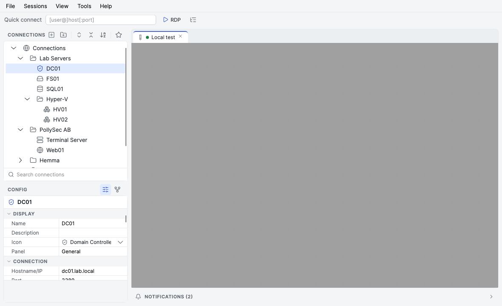
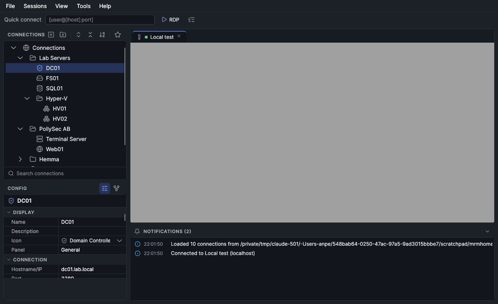

<p align="center">
  
</p>

<h1 align="center">mRemoteMac</h1>

<p align="center">
  The mRemoteNG experience, native on Apple Silicon.<br>
  A tabbed RDP connection manager for macOS that reads and writes mRemoteNG's <code>confCons.xml</code>.
</p>

<p align="center">
  <a href="https://github.com/PollySec/mremotemac/actions/workflows/ci.yml"></a>
  <a href="https://github.com/PollySec/mremotemac/releases/latest"></a>
  
  
  
  <a href="LICENSE"></a>
</p>

<p align="center">
  
</p>
<p align="center">
  
</p>

## Why

[mRemoteNG](https://mremoteng.org) is the connection manager many Windows admins live in all day. On a Mac the
choice has been a VM, a web port, or a client that cannot read your existing connection tree. mRemoteMac is a
clean-room port of the parts that matter for RDP work: the same layout, the same tree, the same config panel,
the same file format, running as a native arm64 app with sessions embedded in tabs.

## Highlights

- **Embedded RDP sessions in tabs**, rendered through [FreeRDP 3](https://www.freerdp.com) with the graphics
  pipeline (RemoteFX / progressive codec), dynamic resolution, remote cursors, clipboard text, audio redirection,
  drive, printer and smart card redirection, RD Gateway and Restricted Admin / Remote Credential Guard.
- **Your existing `confCons.xml` just works.** ConfVersion 2.6 to 2.9, folders, inheritance, master password and
  full-file encryption are read and written with mRemoteNG's exact AES-GCM scheme, so one file can be shared
  between Windows and Mac. Legacy (pre-2.6) files are imported too.
- **The mRemoteNG layout, refined**: connection tree with search, favourites and quick connect, a categorised
  property grid, session tabs and a notifications panel, in a restrained "Graphite + Indigo" design system
  with [Lucide](https://lucide.dev) icons and light and dark appearance (see [docs/design.md](docs/design.md)).
- **Native and fast**: compiled ahead of time to a single arm64 executable (.NET 10 NativeAOT, no runtime, no JIT,
  no IL in the bundle, about 53 MB on disk including FreeRDP and Skia), zero-copy framebuffer path from FreeRDP
  into the GPU-backed surface, no Rosetta, no Electron, no browser.
- **Honest security**: certificates are verified and prompted for exactly like FreeRDP's own clients (trust is
  stored in `~/Library/Application Support/mRemoteMac/freerdp`), credentials never leave the encrypted connection file, and nothing phones home.

## Install

Download the latest `.dmg` from the [releases page](https://github.com/PollySec/mremotemac/releases/latest), open
it and drag **mRemoteMac** to Applications. Requirements: macOS 14 (Sonoma) or newer on Apple Silicon.

The app is ad-hoc signed. On first launch macOS will say it cannot verify the developer: right-click the app,
choose **Open**, and confirm once.

On first start mRemoteMac creates an empty connection file in
`~/Library/Application Support/mRemoteMac/confCons.xml`. Use **File ▸ Import mRemoteNG File…** to bring in an
existing tree, or **File ▸ Open Connection File…** to work directly on a file you share with mRemoteNG.

## Using it

| Where | What |
|---|---|
| Connection tree | Double-click to connect, right-click for Connect (console, fullscreen, view only, without credentials), Duplicate (⌘D), Rename (F2), Delete, Move (⌘↑ / ⌘↓), Sort, Inheritance, Import/Export |
| Search box | Type to jump to the first match, ↑/↓ for next/previous, ⏎ to connect, Esc back to the tree |
| Config panel | mRemoteNG's categories and names (Display, Connection, Protocol, RD Gateway, Appearance, Redirect, Miscellaneous); the second toolbar button switches to the inheritance view |
| Quick connect | `[user@]host[:port]`, ⏎ to connect; history is remembered |
| Session tabs | ⌘← / ⌘→ or ⌘1‥9 to switch, ⌘W to disconnect, right-click for Reconnect, SmartSize, View only, Fullscreen, Rename, Send Ctrl+Alt+Del |
| Keyboard | ⌘ acts as Ctrl inside sessions by default (configurable to Win or Alt in Options), F11 toggles fullscreen |

Resolution behaviour follows mRemoteNG: **Automatic Resize** / **FitToWindow** keep the remote desktop at the
size of the tab (dynamic resolution), **SmartSize** scales a fixed desktop to fit.

## Compatibility

| Area | Status |
|---|---|
| mRemoteNG file format | ✅ ConfVersion 2.6–2.9 read/write, master password, full-file encryption, legacy import (verified against mRemoteNG's own test vectors) |
| RDP core, TLS, NLA/CredSSP, certificate prompts, dynamic resolution, cursors, clipboard text | ✅ verified end-to-end against FreeRDP's test server |
| Clipboard: text both ways (Mac ⇄ session), on by default for new connections | ✅ `Redirect ▸ Clipboard` per connection; files and images are not transferred |
| Windows Server / Windows 11 hosts, RD Gateway, audio, drive/printer redirection | ⚠️ implemented through FreeRDP; please report what you see |
| Connection properties | ✅ every property shown in the config panel is wired (idle timeout, tab and frame colours, sound quality, drives, gateway, …) and has help text; Panel, RDP Version, Enhanced Mode, Key Combinations and external tools have no equivalent here, so they are hidden but preserved in the file |
| Protocols other than RDP (SSH, VNC, HTTP, …) | ❌ by design; entries are kept in the file untouched, shown dimmed and cannot be opened |
| Intel Macs | ❌ arm64 only |

## Build from source

Prerequisites: Xcode Command Line Tools and the .NET 10 SDK. Homebrew is **not** required; CMake, OpenSSL and
FreeRDP are fetched and built by the script below into `../mRemoteMac-deps`.

```sh
git clone https://github.com/PollySec/mremotemac.git && cd mremotemac
./native/build-deps.sh          # once: CMake, OpenSSL 3.5 (static), FreeRDP 3.32 (shared) — about 5 minutes
./native/build.sh               # the C shim, copies the FreeRDP dylibs next to it
dotnet build src/MRemoteMac     # or open mRemoteMac.sln in Rider / VS Code
dotnet run --project src/MRemoteMac

dotnet test tests/MRemoteMac.Tests      # file format and crypto tests
./packaging/make-app.sh                 # NativeAOT dist/mRemoteMac.app + .zip + .dmg (needs clang from Xcode CLT)
```

The app is published with NativeAOT, so everything must stay trim- and AOT-clean: compiled XAML bindings
(`x:DataType`), source-generated JSON, no `Enum.GetValues(Type)` or `GetType().GetProperty(...)`. Release builds
run the trim/AOT analyzers with warnings as errors, so a violation fails the build rather than the user.

Versioning uses [MinVer](https://github.com/adamralph/minver): tag `vX.Y.Z` and the build, the bundle and the
release carry that version.

## How it is built

```
┌──────────────────────────── Avalonia UI (.NET 10) ────────────────────────────┐
│ Views/MainWindow        tree · property grid · tabs · notifications · menus   │
│ ViewModels/ConnectionTab  session lifecycle, prompts, clipboard               │
│ Rdp/RdpView             embedded surface: WriteableBitmap, input, cursors     │
│ Rdp/RdpSession          managed session, UnmanagedCallersOnly callbacks       │
│ Rdp/Native              LibraryImport bindings                                │
├──────────────────────────── native/libmrrdp.dylib (C) ────────────────────────┤
│ one flat API over libfreerdp-client: connect thread, gdi framebuffer,         │
│ input, pointer, cliprdr (text), disp (dynamic resolution), certificate/auth   │
├──────────────────────────── FreeRDP 3 + OpenSSL 3 ────────────────────────────┤
│ built from source for arm64, channels linked statically into the client lib   │
└───────────────────────────────────────────────────────────────────────────────┘
```

Frames go from FreeRDP's GDI buffer straight into the Avalonia bitmap on the RDP thread (one copy, dirty
rectangles only); the UI thread merely invalidates. Prompts that FreeRDP needs answered synchronously
(certificate, credentials) are marshalled to the UI thread while the RDP thread waits.

Measurements, the frame-path cost model and the experiments that did not pay off are in
[docs/performance.md](docs/performance.md).

`Config/ConnectionsFile.cs` and `Config/Crypto.cs` implement the mRemoteNG serializer: PBKDF2-HMAC-SHA1 key
derivation, AES-GCM with a 16-byte nonce and the salt as associated data, exactly as mRemoteNG writes it.

## Contributing

Issues and pull requests are welcome. Please run the test suite and keep the build warning-free (the project
builds with `latest-recommended` analyzers and `-warnaserror` in CI). A debug build has a scripted UI audit
harness (`MRM_SCRIPT=…`, see `Services/UiTestRunner.cs`) that drives real pointer and keyboard events; use it to
cover UI changes.

## License and credits

mRemoteMac is free software under the [GNU General Public License v2](LICENSE), the same license as mRemoteNG.
It is not affiliated with the mRemoteNG project. FreeRDP is licensed under the Apache License 2.0. Interface icons
are [Lucide](https://lucide.dev) (ISC). Built and maintained by [PollySec Labs AB](https://github.com/PollySec).
